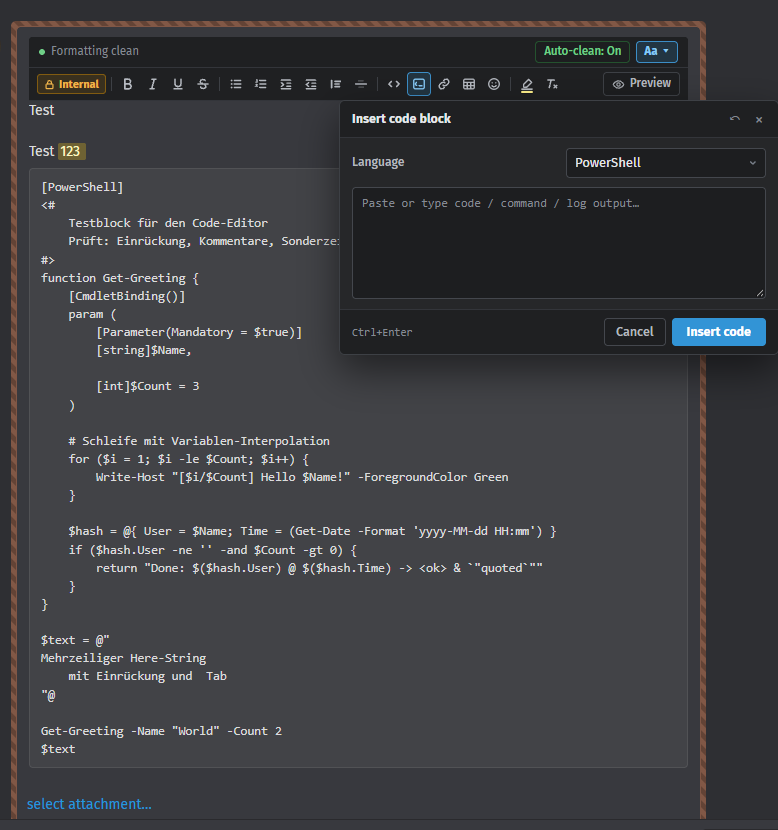
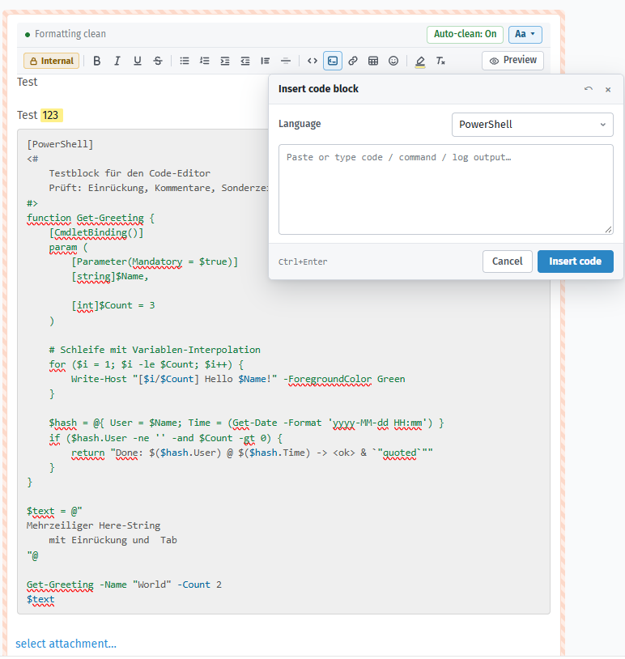
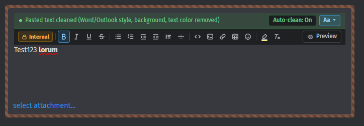
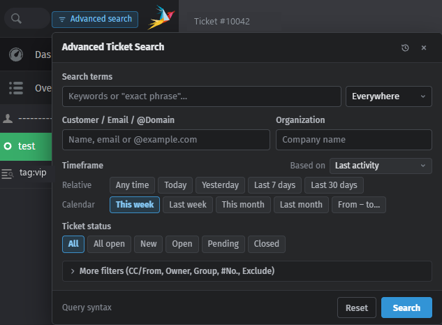
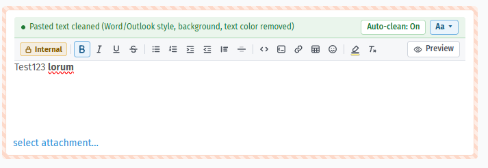
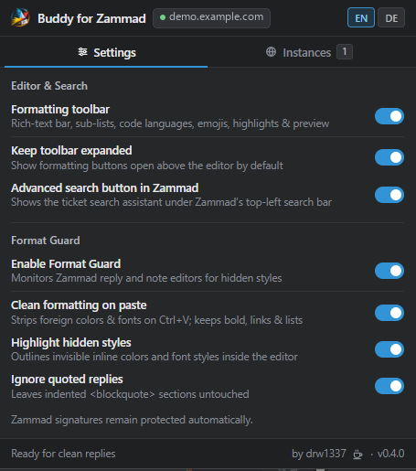

#  Buddy for Zammad

A lightweight browser extension for [Zammad](https://zammad.org) agents: a formatting toolbar for the reply editor,
a visual advanced ticket search, a light-background email preview and a paste format guard.

[](https://github.com/drw1337/Zammad-Buddy/releases/latest)


[](LICENSE)

> **Note:** This is an independent community project. It is not affiliated with, endorsed by or supported by
> Zammad GmbH or the Zammad Foundation. Please report issues with this extension here, not to Zammad.



## Features

### Formatting toolbar

Works directly on Zammad's own editor (`[data-name="body"][contenteditable="true"]`). There is no iframe and no
replacement editor, so text modules (`::`), mentions (`@`), image uploads, undo history and signatures keep working.

- Bold, italic, underline, strikethrough, quotes, dividers and clear formatting.
- Bulleted and numbered lists with real nested sub-lists (toolbar or `Tab` / `Shift+Tab`).
- Inline code (`Ctrl+Shift+C`) and code blocks with syntax highlighting for Bash, PowerShell, JSON, SQL,
  JavaScript/TypeScript, Python, YAML, HTML/XML, PHP and CSS.
- Links (`Ctrl+K`) with URL validation, tables (6×6 picker, `Tab` moves between cells) and an emoji picker with
  English and German search and recently used emojis.
- Knows whether the draft is a **public reply** or an **internal note**. Internal notes get four highlight
  marker colors; if a draft with markers is switched to a public reply, the Format Guard flags them immediately.

### Email preview and paste format guard

- **Email preview:** shows the outgoing reply on a white email background (`Esc` returns to the editor), so
  agents working in dark mode can spot unreadable colors before sending.
- **Paste cleanup:** removes hidden dark-mode, Outlook and Word colors, backgrounds and foreign fonts on paste,
  while keeping bold, italics, links, lists, quotes and signatures.
- **X-ray outline:** marks remaining hidden inline formatting in the editor, with one-click cleanup.

### Advanced ticket search

A small **Advanced search** button below Zammad's search field opens a search builder that writes correct
Zammad / Elasticsearch syntax:

- Customer names (`First Last` → `firstname` AND `lastname`), exact email addresses and whole domains
  (`@example.com` across customer email, organization and article headers).
- Time ranges (today, yesterday, this week, last week, 30 days, custom) on Zammad's timestamp fields, ticket
  states, From/To/CC, owner, ticket number, group, tags and excluded words (`!(…)`).
- Optional live syntax view, saved search presets and a local history of recent searches.
- The search window and the toolbar popovers can be moved by their title bar; the position is remembered
  (double-click the title bar to reset).

### Popup

Two tabs (settings and instances) with live English/German switching. Zammad instances are added by URL and
granted one by one through `optional_host_permissions`.

## Screenshots

Screenshots from a real Zammad instance with neutral test data; host names and ticket numbers are anonymized.

|                                                                                            |                                                                                           |
| ------------------------------------------------------------------------------------------ | ----------------------------------------------------------------------------------------- |
|                  |  |
| **Code blocks** with a language selection; popovers can be moved and remember their place. | **Format Guard** strips Word/Outlook colors and fonts when you paste.                     |
|                             |         |
| **Advanced search** writes correct Zammad query syntax for you, with a search history.     | **More filters**: email headers, owner, group, ticket number, tags, exclusions.           |
|                       |                                     |
| Works with Zammad's **light and dark** theme.                                              | **Popup settings**, English and German.                                                   |

## Why a browser extension and not a contribution to Zammad?

Zammad is open source, so the obvious question is why these features are not developed in a branch of Zammad itself.

- **Zammad is in a transition.** A new major version is currently in beta. Changing the current interface now
  would mean working on code that is about to be replaced. Once the new version is stable, I would like to
  contribute suitable features upstream and work on them with the Zammad community.
- **Problems in daily support work need a fix now.** This extension solves concrete problems of a running Zammad
  instance immediately, without going through support requests and the official release cycle.
- **No server changes.** The extension runs only in the agent's browser. It does not modify the Zammad
  installation, needs no admin access to the server and works with self-hosted and cloud instances.

The extension depends on Zammad's interface. Zammad updates, and especially the new interface, may require
adjustments here.

## Privacy & security

- No analytics, no tracking, no external network requests.
- Runs only on Zammad instances you add yourself; each host is granted individually at runtime.
- Permissions: `storage`, `scripting`, `activeTab` – nothing else. Settings stay in the browser.
- Markup is parsed in an inert document (`DOMParser`), never via `innerHTML` on the page, and limited to what
  Zammad's server-side sanitizer accepts. Links are restricted to `https:`, `http:`, `mailto:`, `tel:` and
  relative targets.
- Details: [PRIVACY.md](PRIVACY.md).

## Installation

| Browser               | Install                                                                                                 |
| --------------------- | ------------------------------------------------------------------------------------------------------- |
| Firefox               | Firefox Add-ons – link follows after review                                                             |
| Chrome / Brave        | Chrome Web Store – link follows after review                                                            |
| Edge                  | Edge Add-ons – link follows after review                                                                |
| Manual (all browsers) | Packages and SHA-256 checksums on the [releases page](https://github.com/drw1337/Zammad-Buddy/releases) |

After installing, open the extension popup, add your Zammad URL under **Instances** and confirm the permission
prompt.

## Architecture

Plain JavaScript, no framework and no runtime dependencies. Content scripts are classic scripts that register
themselves on one shared namespace (`globalThis.ZammadBuddy`). Every module also exports itself via CommonJS, so
the same files run unchanged in the Node test runner.

```text
├── manifest.json            Shared MV3 manifest (build.js derives the per-browser variants)
├── background.js            Registers content scripts per granted instance; owns the load order
├── content.js               Entry point: loads settings and starts the observer
├── core/
│   ├── theme.css            Light/dark design tokens shared by all UI (in-page and popup)
│   ├── locales/             English and German texts
│   ├── i18n.js              Key lookup, placeholders, data-i18n DOM translation
│   ├── storage.js           Settings, instance parsing and deduplication
│   ├── zammad-dom.js        Every selector this extension assumes about Zammad's DOM
│   ├── editor-context.js    Public reply vs. internal note detection
│   ├── dom-observer.js      Feature registry; attaches features to each editor
│   ├── safe-html.js         Inert HTML parsing (DOMParser) instead of innerHTML
│   └── search-query.js      Search compiler (search-query/: date ranges, clauses)
├── features/
│   ├── format-guard/        Status bar, paste handling; sanitizer/: rules, detector, cleaner
│   ├── search-helper/       Search trigger and flyout; panel/: kit, filters, presets, syntax drawer
│   └── wysiwyg/
│       ├── commands.js      Facade over the editor modules (stable API for UI and tests)
│       ├── editor/          dom, blocks, lists, tables, links, note-highlight,
│       │                    code-highlight, emoji-catalog, formatting, preview-sanitizer
│       ├── ui/              icons, email preview, popovers (frame, code, link, emoji, table, highlight)
│       └── index.js         Toolbar controller and keyboard handling
├── popup/                   Extension popup (lib/: browser API, settings tab, instances tab)
├── icons/                   Extension icons (16–128 px)
├── docs/screenshots/        README screenshots (anonymized)
├── scripts/                 build.js (dist/chrome, dist/firefox), package.js (release ZIPs, checksums)
└── test/                    node:test suites, a minimal DOM parser and an offline Zammad sandbox
```

Design rules the code follows:

- Never replace or wrap Zammad's editor; never touch the signature block.
- In-page forms use real Light-DOM inputs with event shielding, so Zammad's global shortcuts cannot steal focus.
- Generated markup is limited to what Zammad's `html_sanitizer.rb` keeps (inline colors, semantic tags).

## Development

Requires Node.js 22 or newer. The dev dependencies (ESLint, Prettier, web-ext) are only used for development.

```bash
npm install          # dev tools only
npm test             # unit tests, load-order and manifest checks
npm run lint         # ESLint
npm run format:check # Prettier
npm run lint:firefox # Mozilla's add-on linter (web-ext) on dist/firefox
npm run check        # all of the above
npm run build        # dist/chrome and dist/firefox
npm run package      # dist/release: Chrome/Edge and Firefox ZIPs + SHA256SUMS.txt
```

Load the build output for testing:

- **Chrome / Edge / Brave:** `chrome://extensions` → **Developer mode** → **Load unpacked** → `dist/chrome`.
- **Firefox:** `about:debugging#/runtime/this-firefox` → **Load Temporary Add-on…** →
  `dist/firefox/manifest.json` (removed when Firefox restarts). For a permanent test install, sign the package
  as an unlisted add-on with your own [AMO API key](https://addons.mozilla.org/developers/addon/api/key/):
  set `WEB_EXT_API_KEY` and `WEB_EXT_API_SECRET`, run `npm run sign:firefox` and install the `.xpi` from
  `dist/signed/`. Every signed upload needs a new version number.

`test/mock-zammad.html` is an offline sandbox that imitates Zammad's editor and search field. Open it locally to
try every feature without a Zammad instance.

## Contributing

This is a personal project. Pull requests are welcome as suggestions; I review each one and decide whether to merge
it. For larger changes, please open an issue or discussion first. See [CONTRIBUTING.md](CONTRIBUTING.md).

## Security

Please do not report security vulnerabilities in public issues. Use
[private vulnerability reporting](../../security/advisories/new) instead. See [SECURITY.md](SECURITY.md).

## License

MIT License, see [LICENSE](LICENSE).

## Credits

- [Zammad](https://github.com/zammad/zammad) is an open source helpdesk system (AGPL-3.0). This extension contains
  no Zammad code.
- "Zammad" is a trademark of its respective owner. It is used here only to describe what this extension works with.
- Development: [drw1337](https://github.com/drw1337) · [Buy Me a Coffee](https://buymeacoffee.com/meyn)
